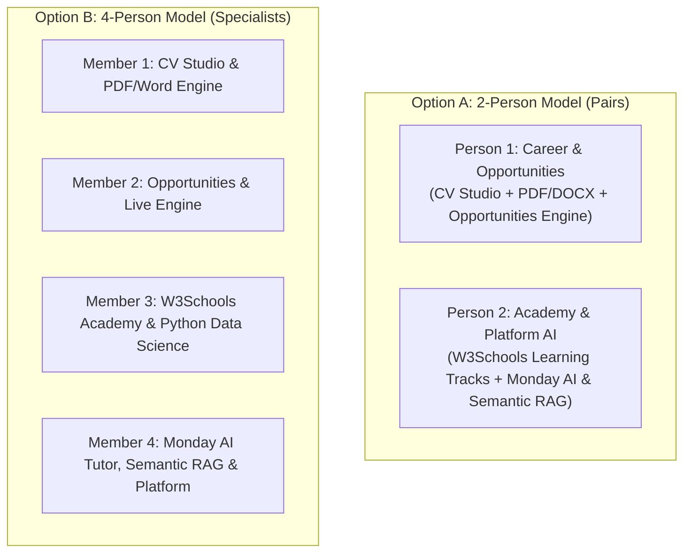
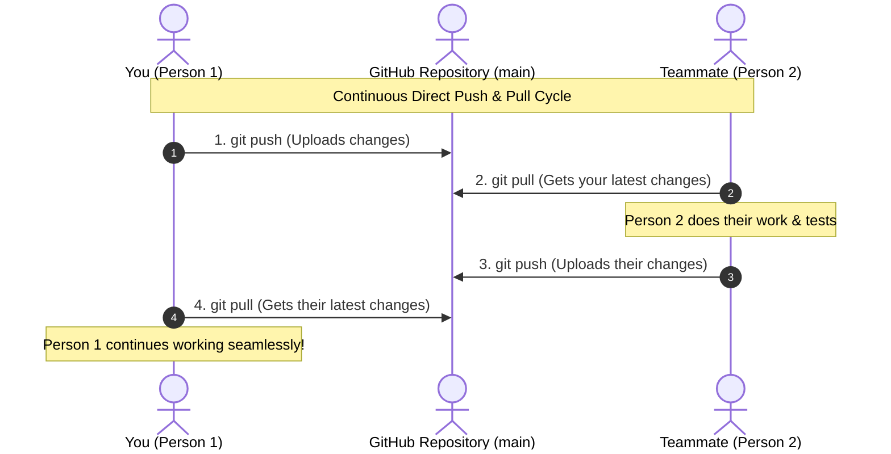

# CampusOS Team Onboarding & Collaboration Guide

Welcome to the **CampusOS** engineering team! This guide is designed to be **flexible for either 2, 3, or 4 contributors**, so your team can jump in immediately regardless of how many people are working on the project.

---

## 1. Public Repository Access & Quick Setup

The repository is **100% Public** on GitHub:
👉 **[https://github.com/rajeelahmad-main/CampusOS](https://github.com/rajeelahmad-main/CampusOS)**

Because it is public, any team member can clone, view, and run it immediately without needing repository invitations or SSH token setups.

### Prerequisites
- **Node.js**: v18+ or v20+ recommended (LTS)
- **Git**: Installed and configured on your machine

### 3-Step Setup
1. **Clone the Repository**:
   ```bash
   git clone https://github.com/rajeelahmad-main/CampusOS.git
   cd CampusOS
   ```
2. **Install Dependencies**:
   ```bash
   npm install
   ```
3. **Configure Environment**:
   Copy `.env.example` to `.env.local`:
   ```bash
   # On Windows (PowerShell):
   Copy-Item .env.example .env.local

   # On macOS/Linux:
   cp .env.example .env.local
   ```
   *(Optional: Add your Gemini API key to `GEMINI_API_KEY` in `.env.local` for live AI inference, or leave it blank to run the built-in local engine with offline fixtures).*

4. **Start Local Development Server**:
   ```bash
   npm run dev
   ```
   Open [http://localhost:3002](http://localhost:3002) in your browser.

5. **Run the Test Suite**:
   ```bash
   npm test
   ```
   *(Ensure all 191 tests pass before pushing any changes).*

---

## 2. Flexible Team Work Division (2-Person or 4-Person Setup)

Choose either **Model A (2 Persons)** or **Model B (4 Persons)** based on your current team size:



---

### Option A: 2-Person Model (Broad Ownership)

If 2 team members are developing CampusOS, the codebase naturally splits into **Career & Recruitment** vs **Learning & Platform AI**:

#### Person 1: Career, CV Studio & Opportunity Finder
- **Scope**: All resume creation, PDF/Word generation, AI CV auditing, and external opportunity discovery.
- **Primary Directories & Files**:
  - `src/components/cv/` (`RegionalCvPreview.tsx`, template components)
  - `src/lib/cv-parser.ts`, `src/lib/pdf-generator.ts`, `src/lib/docx-generator.ts`
  - `src/app/cv/page.tsx`, `src/app/api/ai/cv/route.ts`
  - `src/app/opportunities/page.tsx`, `src/lib/opportunity-search.ts`, `src/app/api/ai/opportunity/route.ts`
- **Key Deliverables**:
  1. Remove hardcoded `"SublimeTechs Software House"` and `"WordPress Developer"` dummy overrides in `RegionalCvPreview.tsx`, `pdf-generator.ts`, and `docx-generator.ts`.
  2. Fix PDF line-height bounding calculation (`y -= dynamicHeight`) so long bullet points never overlap headers or body text.
  3. Purge forbidden `"Pakistan Corporate & Software House Standard (HEC/PEC Accredited)"` and `"COMP/2026-48192"` titles from templates and default states.
  4. Replace unverified 2027 opportunity dates with active rolling cycles, resolve Bing search redirect URLs to canonical destination job links, and implement live AI DOM verification.

#### Person 2: W3Schools Academy, Monday AI Tutor & Core Platform
- **Scope**: Interactive learning systems, roadmaps, conversational AI assistant, and semantic vector RAG.
- **Primary Directories & Files**:
  - `src/lib/w3schools-data.ts`, `src/components/learn/`, `src/app/roadmaps/`
  - `src/app/tutor/page.tsx`, `src/lib/ai-provider.ts`, `src/lib/rag-engine.ts`
  - `src/app/courses/page.tsx`, `src/app/dashboard/page.tsx`, `src/app/codeplay/page.tsx`
- **Key Deliverables**:
  1. Complete W3Schools Python curriculum (File Handling `open/read/write`, Advanced OOP, Database integration) and add Data Science chapters (NumPy, Pandas, Matplotlib, ML foundations).
  2. Redesign Monday AI tutor prompts for natural ChatGPT-style conversational responses without formulaic rigid headers.
  3. Implement paragraph-boundary and code-fence-aware semantic RAG chunking in `rag-engine.ts`.
  4. Fix course enrollment state in `src/app/courses/page.tsx` so class codes persist `isEnrolled: true` in `store.ts`.
  5. Enhance CodePlay execution to support Python variables, arithmetic, and basic loops.

---

### Option B: 4-Person Model (Specialized Modules)

If 4 team members are working, divide the system into 4 distinct modules to prevent file collisions:

#### Member 1: CV Studio, Templates & PDF/Word Generator
- **Focus**: CV parsing, regional templates, export engines.
- **Files**: `src/components/cv/*`, `src/lib/cv-parser.ts`, `src/lib/pdf-generator.ts`, `src/lib/docx-generator.ts`, `src/app/cv/page.tsx`.
- **Tasks**:
  - Remove all dummy data overrides (`SublimeTechs`, `WordPress Developer`).
  - Fix PDF multi-line text collision and calculate accurate bounding-box offsets.
  - Purge PEC titles and numbers across all 12 templates.
  - Support arbitrary candidate sections (Clinical, Legal, Research).

#### Member 2: Opportunity Finder & Live Verification Engine
- **Focus**: Internship/job aggregation, canonical URL resolution, DOM verification.
- **Files**: `src/app/opportunities/page.tsx`, `src/lib/opportunity-search.ts`, `src/app/api/ai/opportunity/route.ts`.
- **Tasks**:
  - Replace static 2027 deadlines with rolling active 2026 application windows.
  - Unpack Bing search redirects (`bing.com/ck/a?...`) into direct corporate career links.
  - Add AI DOM validation to flag closed or 404 postings with visual warning badges.

#### Member 3: W3Schools Academy & Learning Tracks
- **Focus**: Comprehensive curricula, interactive code sandbox, roadmaps.
- **Files**: `src/lib/w3schools-data.ts`, `src/components/learn/*`, `src/app/roadmaps/*`.
- **Tasks**:
  - Expand Python with File I/O, OOP inheritance, SQLite database connections.
  - Build NumPy, Pandas, Matplotlib, and Machine Learning chapters with live code snippets.
  - Expand JavaScript (Promises, Async/Await) and SQL (Aggregations, Transactions).

#### Member 4: Monday AI Tutor, Semantic RAG & Core Platform
- **Focus**: Natural conversational AI, slide/note RAG chunking, teacher/student views.
- **Files**: `src/app/tutor/page.tsx`, `src/lib/rag-engine.ts`, `src/lib/ai-provider.ts`, `src/app/courses/*`, `src/app/dashboard/*`, `src/app/codeplay/*`.
- **Tasks**:
  - Format Monday AI replies in fluid, conversational markdown like ChatGPT.
  - Replace 500-char naive chunking with boundary-aware semantic chunking.
  - Implement class code enrollment persistence in Zustand store.
  - Add Teacher Command Grid to `/dashboard`.

---

### Option C: 3-Person Hybrid Model
If 3 people are working:
- **Member 1**: CV Studio & Export Engine (Member 1 tasks above).
- **Member 2**: Opportunities & Live Search Engine (Member 2 tasks above).
- **Member 3**: Academy, Monday AI Tutor & Core Platform (Members 3 & 4 tasks combined).

---

## 3. The Simple "Pull — Work — Push" Workflow

For fast and straightforward collaboration, you don't need complex branch rituals or PR reviews. The team can work directly using the classic collaborative loop:



### The 4 Daily Commands (All You Need)

Whenever you start working:
```bash
# 1. Always pull before you begin
git pull origin main

# 2. Do your coding / bug fixes...
# Verify tests pass:
npm test

# 3. Save your changes
git add .
git commit -m "feat: description of what was fixed or added"

# 4. Push directly to GitHub
git push origin main
```

---

## 4. How to Invite Teammates for Direct Push Access

The repository is **Public**, so anyone can view and clone it. To let your teammates push directly (`git push origin main`), invite them as a Collaborator with Write Access:

### Method A: Via Web Browser (10 Seconds)
1. Go to: **[https://github.com/rajeelahmad-main/CampusOS/settings/access](https://github.com/rajeelahmad-main/CampusOS/settings/access)**
2. Click the green button: **"Add people"**
3. Type your teammate's **GitHub username** or **email**.
4. Click **"Add [username] to this repository"**.
5. Your teammate will receive an email invitation or can accept it directly at `https://github.com/rajeelahmad-main/CampusOS/invitations`.
6. Once accepted, they can run `git push origin main` directly!

### Method B: Via Terminal / GitHub CLI
If you know their GitHub username, you can invite them immediately:
```bash
gh api --method PUT /repos/rajeelahmad-main/CampusOS/collaborators/<THEIR_GITHUB_USERNAME>
```

---

## 5. What If Both People Push at the Same Time? (Quick Fix)

If your teammate pushed changes while you were editing:
1. `git push` will say: *"fetch first (remote contains work you do not have)"*.
2. Simply run:
   ```bash
   git pull --rebase origin main
   git push origin main
   ```
3. That's it! Git automatically places your changes on top of their latest work.

---

## 6. Key Reference Documents in Repository

- **[CAMPUSOS_PLATFORM_PROBLEMS_AUDIT.md](./CAMPUSOS_PLATFORM_PROBLEMS_AUDIT.md)**: Master problems audit with exact line-by-line root causes and bug locations.
- **[README.md](./README.md)**: Complete system architecture and feature reference.
- **[TEST_READY.md](./TEST_READY.md)**: Test verification guidelines and test file catalog.

   Review each other's code, confirm the test suite passes, and merge to `main`.

---

## 4. Key Reference Documents in Repository

- **[CAMPUSOS_PLATFORM_PROBLEMS_AUDIT.md](./CAMPUSOS_PLATFORM_PROBLEMS_AUDIT.md)**: Master problems audit with exact line-by-line root causes and bug locations.
- **[README.md](./README.md)**: Complete system architecture and feature reference.
- **[TEST_READY.md](./TEST_READY.md)**: Test verification guidelines and test file catalog.
