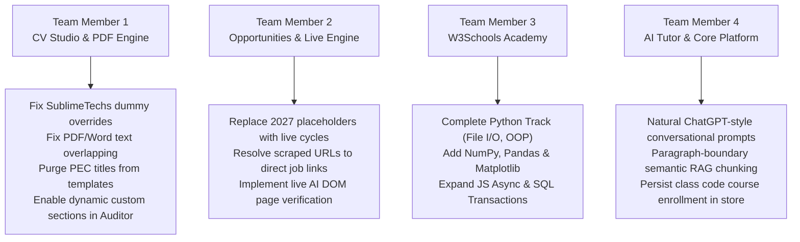

# CampusOS Team Onboarding & Collaboration Guide

Welcome to the **CampusOS** engineering team! This guide helps all 4 team members quickly set up their local development environments, understand the codebase architecture, and coordinate feature delivery without merge conflicts.

---

## 1. Quick Setup for Team Members (First Time Setup)

### Prerequisites
- **Node.js**: v18+ or v20+ recommended (LTS)
- **Git**: Installed and configured on your machine

### 3-Step Setup
1. **Clone the Repository**:
   ```bash
   git clone https://github.com/rajeelahmad-main/CampusOS.git
   cd CampusOS
   ```
2. **Install Dependencies**:
   ```bash
   npm install
   ```
3. **Configure Environment**:
   Copy `.env.example` to `.env.local`:
   ```bash
   # On Windows (PowerShell):
   Copy-Item .env.example .env.local

   # On macOS/Linux:
   cp .env.example .env.local
   ```
   *(Optional: Add your Gemini API key to `GEMINI_API_KEY` for live AI inference, or leave blank to run the built-in local engine with demo fixtures).*

4. **Start Local Development Server**:
   ```bash
   npm run dev
   ```
   Open [http://localhost:3002](http://localhost:3002) in your browser.

5. **Run the Test Suite**:
   ```bash
   npm test
   ```
   *(Ensure all 191 tests pass before pushing any changes).*

---

## 2. 4-Person Work Division & Task Ownership

Based on the [CAMPUSOS_PLATFORM_PROBLEMS_AUDIT.md](./CAMPUSOS_PLATFORM_PROBLEMS_AUDIT.md), the remaining tasks are divided across 4 roles:



### Team Member 1: CV Studio, Templates & AI Auditor
- **Primary Files**:
  - `src/components/cv/RegionalCvPreview.tsx`
  - `src/lib/cv-parser.ts`
  - `src/lib/pdf-generator.ts`
  - `src/lib/docx-generator.ts`
  - `src/app/api/ai/cv/route.ts`
- **Key Tasks**:
  - Remove hardcoded `"SublimeTechs Software House"` and `"WordPress Developer"` overrides in `sanitizeExperience`.
  - Fix PDF vertical coordinates (`y -= dynamicHeight`) so multi-line bullets don't overlap succeeding headings.
  - Remove `"Pakistan Corporate & Software House Standard (HEC/PEC Accredited)"` and `"COMP/2026-48192"` from all templates and default state.
  - Update `CvData` and the AI Auditor prompt to preserve custom candidate sections (Clinical, Legal, Engineering).

---

### Team Member 2: Opportunity Finder & Live Search
- **Primary Files**:
  - `src/app/opportunities/page.tsx`
  - `src/lib/opportunity-search.ts`
  - `src/app/api/ai/opportunity/route.ts`
- **Key Tasks**:
  - Replace unverified 2027 dates with active, rolling 2026/immediate recruitment periods.
  - Resolve search redirect URLs (`bing.com/ck/a?...`) to canonical destination job links.
  - Enhance `verifyOpportunityUrl` with AI DOM inspection to confirm job openings are active.
  - Ensure card details (title, company, description) strictly match destination links.

---

### Team Member 3: W3Schools Academy & Learning Tracks
- **Primary Files**:
  - `src/lib/w3schools-data.ts`
  - `src/components/learn/W3CourseStudio.tsx`
  - `src/components/learn/W3InteractiveLab.tsx`
  - `src/app/roadmaps/page.tsx`
- **Key Tasks**:
  - Expand Python curriculum with File Handling (`open`, `read`, `write`, `delete`), Advanced OOP, and Database connectivity (SQLite/MySQL).
  - Add Data Science / AI chapters: NumPy, Pandas, Matplotlib, and Machine Learning foundations.
  - Expand companion tracks (JavaScript Async/Await, CSS Grid, SQL Window Functions and Transactions).

---

### Team Member 4: Monday AI Tutor, RAG Engine & Core Platform
- **Primary Files**:
  - `src/app/tutor/page.tsx`
  - `src/lib/ai-provider.ts`
  - `src/lib/rag-engine.ts`
  - `src/app/courses/page.tsx`
  - `src/app/dashboard/page.tsx`
  - `src/app/codeplay/page.tsx`
- **Key Tasks**:
  - Refactor Monday AI system prompts to eliminate formulaic, rigid headings and enable natural, conversational ChatGPT-style formatting.
  - Implement paragraph-boundary and code-fence-aware semantic RAG chunking in `rag-engine.ts`.
  - Fix course enrollment form in `src/app/courses/page.tsx` so entering a class code actually sets `isEnrolled: true` in `store.ts`.
  - Render a dedicated Faculty Command Grid on `/dashboard` when `user.role === 'teacher'`.
  - Improve CodePlay Python execution to handle variables, loops, and math beyond simple `print` regex.

---

## 3. Git Workflow & Collaboration Rules

To avoid merge conflicts, follow standard feature-branch conventions:

1. **Always pull latest changes before starting work**:
   ```bash
   git checkout main
   git pull origin main
   ```
2. **Create a dedicated branch for your task**:
   ```bash
   # Team Member 1:
   git checkout -b feature/cv-overhaul

   # Team Member 2:
   git checkout -b feature/opportunity-live-search

   # Team Member 3:
   git checkout -b feature/w3schools-curricula

   # Team Member 4:
   git checkout -b feature/tutor-rag-platform
   ```
3. **Test your code before committing**:
   ```bash
   npm test
   npm run build
   ```
4. **Push your branch to GitHub**:
   ```bash
   git push origin feature/your-branch-name
   ```
5. **Open a Pull Request on GitHub**:
   Review each other's code, confirm the test suite passes, and merge to `main`.

---

## 4. Key Reference Documents in Repository

- **[CAMPUSOS_PLATFORM_PROBLEMS_AUDIT.md](./CAMPUSOS_PLATFORM_PROBLEMS_AUDIT.md)**: Master problems audit with exact line-by-line root causes and bug locations.
- **[README.md](./README.md)**: Complete system architecture and feature reference.
- **[TEST_READY.md](./TEST_READY.md)**: Test verification guidelines and test file catalog.
